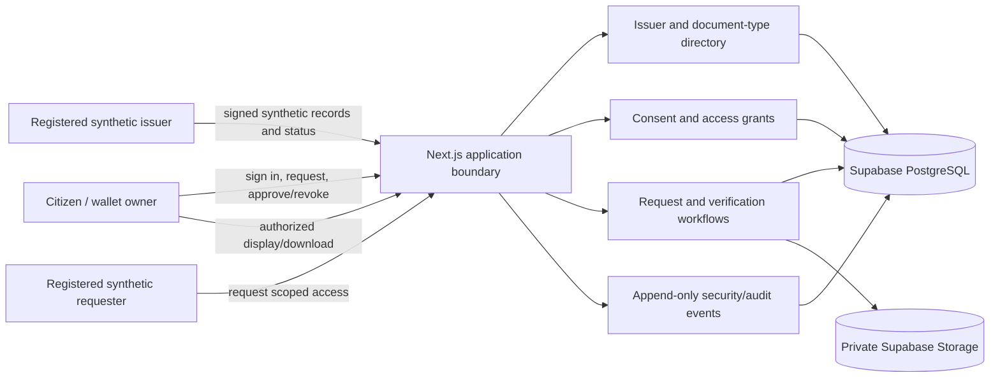

# Architecture roadmap: certificate wallet demo

## Purpose and boundaries

This document translates publicly described DigiLocker patterns into a staged architecture for this independent interview demo. It does not describe DigiLocker's private implementation, claim compatibility with its APIs, or authorize a real integration. The app must not use DigiLocker branding or imply government recognition. All records and organizations remain synthetic until a separately reviewed integration is approved.

The public pattern worth learning from is an ecosystem with distinct citizens, issuers, requesters/verifiers, issuer-controlled repositories, document references, user consent, and traceable access. Our implementation should model those trust boundaries while staying deployable as one Next.js application on Vercel with Supabase PostgreSQL and private Storage.

## Current architecture

The current MVP is a modular monolith:

- **Citizen experience:** Better Auth email/password sessions and an owner-scoped wallet.
- **Application API:** Next.js routes authenticate, validate, authorize, and orchestrate certificate requests and reads.
- **Issuer boundary:** `IssuerAdapter` separates the synthetic issuer from wallet workflow code.
- **Verification:** SHA-256 file integrity, trusted test-key manifest signature, and fresh issuer status are distinct checks.
- **Persistence:** PostgreSQL stores issuer configuration, synthetic lookup fixtures, request lifecycle, wallet metadata, and audit events.
- **File service:** Private Supabase Storage stores PDF objects; Next.js mediates owner-authorized reads.

This is an appropriate deployment shape for the current scale. Modularity belongs in code and database boundaries first; separate services can be considered only after a concrete operational requirement exists.

## Target logical model

The diagram is logical, not a deployment diagram. The modules remain in one application and share the current database/storage providers. Every route still enforces the caller's session and object-level authorization on the server.

## Staged implementation

### Stage 1 — Security foundation and domain boundaries

Do this before adding cross-user sharing:

1. Write a concise threat model: assets, actors, trust boundaries, abuse cases, and explicit demo limitations.
2. Separate route handlers from domain services and provider adapters so that authorization and persistence rules are reviewable in one place.
3. Define role and capability checks from server-side records. Do not accept roles, issuer IDs, owner IDs, or trust keys supplied by a browser as authority.
4. Add rate limits and safe operational events to authentication, certificate lookup, and file access. Keep secrets and lookup fields out of logs.
5. Review session lifetime, logout, recovery, and account verification settings. Keep the existing email/password flow; do not add OAuth as an architecture shortcut.
6. Confirm PostgreSQL connection security and private-bucket settings before any real personal data is considered. The current no-TLS demo connection is not suitable for real personal data.

**Exit check:** access-control rules and threat assumptions are written down; tests can prove a user cannot read another user's documents; operational records are useful without storing certificate contents or lookup values.

### Stage 2 — Issuer directory and issuer operator

Move synthetic issuer fixtures behind an issuer-management boundary rather than treating seeded rows as the only issuer interface:

- Add registered issuer metadata, document types, key identifiers and versions, status endpoint capability, and lifecycle state.
- Add a separate synthetic issuer operator capability for adding/revoking test records and rotating test public keys. Do not give this capability to ordinary citizen accounts.
- Keep the private signing key in a server-side test secret; store only public verification material and key metadata in the issuer registry.
- Add a repository adapter interface for lookup, artifact retrieval, and current-status checks. Keep the current PostgreSQL simulator as its first implementation.
- Record which issuer and key version produced each result. Key rotation must not silently make old documents unverifiable.

**Exit check:** one synthetic issuer can be managed without editing application code, and disabled issuers or unknown/retired keys fail closed.

### Stage 3 — Consent-based, requester-scoped access

Only after Stage 1 and 2:

- Register synthetic requester organizations and their permitted purposes/document types.
- Let a citizen approve access to selected documents for one named requester and purpose, with a clear expiry and a revoke action.
- Require the requester to authenticate as that registered synthetic organization and the citizen to be signed in to approve. Do not build anonymous bearer links as the default.
- Store consent as a stateful grant with owner, requester, selected document IDs, purpose, creation/expiry/revocation times, and a minimal audit trail.
- Enforce the grant on every read. A grant never replaces document ownership, issuer-signature validation, digest checking, or the fresh status check.
- Show the citizen the requester identity, requested documents, purpose, expiry, and access history before approval.

This is a simulation of a consent pattern, not a legal consent mechanism and not a connection to DigiLocker or API Setu.

**Exit check:** a requester can access only the selected document(s), for the approved purpose window; expiry/revocation immediately blocks future access; access and denial are auditable; another requester or citizen cannot reuse the grant.

### Stage 4 — Verifier experience and interoperability surface

- Add a verifier view that reports issuer, document type, signed-manifest result, file integrity result, and the timestamp/result of a fresh status check.
- If QR or URI resolution is added, use opaque, non-sequential references and resolve them only after the appropriate user consent/access check. A reference is never an authorization credential.
- Define versioned API schemas and idempotency behavior before exposing integration endpoints.
- Keep external issuer/requester adapters disabled until partner credentials, callback validation, threat review, and deployment controls are specified.

### Stage 5 — Production readiness review

Before handling real personal records, separately plan and verify: TLS with trusted CA, storage/database access policies, managed secrets, strong account recovery and MFA/step-up authentication, abuse controls, backup/restore, incident response, retention/deletion, independent security assessment, accessibility, and applicable legal/privacy obligations. A demo implementation cannot claim DigiLocker-level security, certification, or compliance.

## Data changes to expect

The current model already has `app_issuers`, `issuer_test_records`, `certificate_requests`, `wallet_documents`, and `audit_events`. Do not add every future table now. When the stages are approved and implemented, likely additions include:

- `issuer_document_types` and versioned `issuer_keys`;
- `issuer_operators` or an equivalent server-authorized capability map;
- `requester_organizations` and registered requester clients;
- `consent_grants` and scoped grant-document links;
- audit event types for consent decisions, grant access, revocation, key changes, and administrative actions.

Each table needs explicit ownership, unique constraints, lifecycle transitions, retention behavior, and server authorization. Avoid role flags embedded in user-editable profile fields. If database row-level security is adopted, establish and test it as a deliberate second control; do not assume a service key is constrained by RLS.

## Recommended next code milestone

Implement **Stage 1 only** first: a threat-model/architecture decision record, extract request and document authorization into a small domain/service layer, and add focused authorization coverage. Preserve the current sign-in UX, Supabase/Vercel deployment, and single-app deployment model. Do not start requester sharing until the Stage 1 rules and Stage 2 issuer-operator model are clear.

## Public references

These sources describe public-facing concepts, not DigiLocker's internal source code or a guarantee that every listed feature is available in every flow:

- [DigiLocker public architecture overview](https://www.digilocker.gov.in/web/architecture)
- [DigiLocker public security architecture overview](https://www.digilocker.gov.in/web/security-architecture)
- [DigiLocker issuer partner information](https://www.digilocker.gov.in/web/partners/issuers)
- [DigiLocker data exchange overview](https://www.digilocker.gov.in/web/data-exchange)
